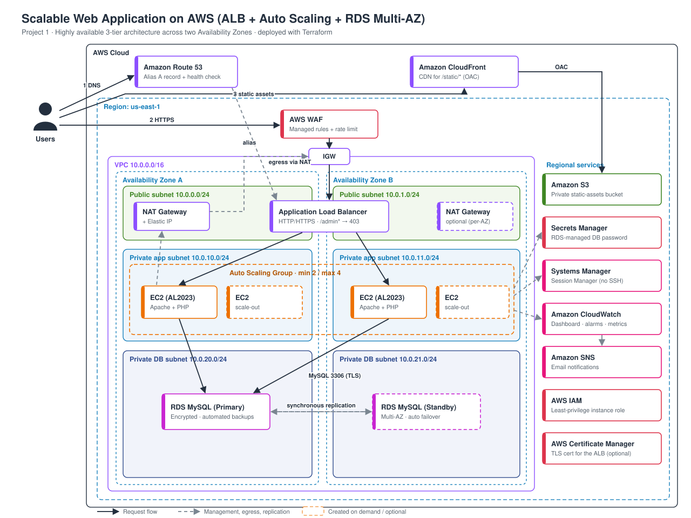

# Scalable Web Application with ALB and Auto Scaling on AWS

**AWS Solutions Architect – Associate · Graduation Project 1 (EC2-based architecture)**

A production-style, highly available three-tier web application deployed entirely with **Terraform**. EC2 instances run in private subnets across two Availability Zones behind an Application Load Balancer protected by AWS WAF. An Auto Scaling Group adds and removes instances based on load, a Multi-AZ RDS MySQL database stores the data, and CloudFront serves static assets from a private S3 bucket.

The demo app ("Visit Ledger") shows **which EC2 instance and which Availability Zone served each request**, and stores every visit in RDS, so load balancing, scaling, self-healing and database failover are all visible in the browser.

---

## Table of contents

1. [Architecture diagram](#architecture-diagram)
2. [AWS services used](#aws-services-used)
3. [How a request flows](#how-a-request-flows)
4. [Design decisions](#design-decisions)
5. [Security](#security)
6. [Scaling and high availability](#scaling-and-high-availability)
7. [Monitoring and alerting](#monitoring-and-alerting)
8. [Repository structure](#repository-structure)
9. [Deployment](#deployment)
10. [Testing and demo scenarios](#testing-and-demo-scenarios)
11. [Cost estimate and clean-up](#cost-estimate-and-clean-up)
12. [Troubleshooting](#troubleshooting)
13. [Well-Architected Framework mapping](#well-architected-framework-mapping)
14. [Future improvements](#future-improvements)

---

## Architecture diagram



---

## AWS services used

| Service | Role in this project |
|---|---|
| **Amazon VPC** | `10.0.0.0/16` with 6 subnets in 2 AZs: public (ALB, NAT), private app (EC2), private DB (RDS). Separate route tables per tier, Security Groups and NACLs. |
| **NAT Gateway** | Outbound-only internet for private instances (package installs, AWS APIs). One by default, one per AZ with `single_nat_gateway = false`. |
| **Amazon EC2 + Auto Scaling** | Launch Template (Amazon Linux 2023, IMDSv2, encrypted gp3), ASG min 2 / max 4 across both AZs, target-tracking **and** step-scaling policies, rolling instance refresh. |
| **Application Load Balancer** | Layer-7 entry point in the public subnets, health checks on `/health.php`, HTTP→HTTPS redirect when a domain is set, listener rule that blocks `/admin*`. |
| **AWS WAF** | Regional Web ACL on the ALB: Amazon IP reputation list, Core Rule Set (OWASP Top 10), Known Bad Inputs, SQL injection rules, and a per-IP rate limit. |
| **Amazon CloudFront + S3** | Static CSS / images in a private, encrypted, versioned bucket, readable only by CloudFront through Origin Access Control. |
| **Amazon RDS (MySQL) Multi-AZ** | Encrypted database in isolated subnets with a synchronous standby in the second AZ, automatic failover, automated backups and storage autoscaling. |
| **AWS Secrets Manager** | RDS creates, stores and rotates the master password (`manage_master_user_password`). No password exists in code, state or user data. |
| **Amazon Route 53 + ACM** *(optional)* | Alias A record to the ALB, DNS-validated TLS certificate, and a Route 53 health check with an alarm. |
| **AWS Systems Manager** | Session Manager for shell access. No SSH keys, no port 22, no bastion host. |
| **Amazon CloudWatch + SNS** | Dashboard, alarms for 5xx errors, unhealthy hosts, latency, CPU and storage, and email notifications. |
| **AWS IAM** | Least-privilege instance role: SSM core permissions plus read access to one specific secret. |

---

## How a request flows

1. The user's browser resolves the app's name through **Route 53** (alias record to the ALB), or uses the ALB DNS name directly if no domain is configured.
2. The HTTPS request reaches the **ALB**, where **WAF** inspects it first. Malicious or rate-exceeding requests are blocked with `403`.
3. The ALB forwards the request to a healthy **EC2 instance** in one of the private app subnets.
4. PHP reads the DB credentials from **Secrets Manager** (cached locally), connects to **RDS** over TLS on port 3306, records the visit and renders the page.
5. The page references CSS and images on **CloudFront**, which serves them from edge caches and fetches misses from the private **S3** bucket.
6. Instances reach the internet only outbound through the **NAT Gateway**. Nothing on the internet can initiate a connection to them.

---

## Design decisions

**Compute in private subnets only.** Instances have no public IPs. The only way in is through the ALB on port 80 (from the ALB's security group), and the only admin path is Session Manager.

**Shallow health check.** `/health.php` returns `200` without touching the database. If the health check queried RDS, a 60-second Multi-AZ failover would mark every instance unhealthy and the ASG would terminate the whole fleet, which would not fix a database problem.

**Password rotation without downtime of the app tier.** RDS rotates the master password automatically. The app caches the credentials and, if MySQL returns error `1045` (access denied), it fetches the new secret once and retries. See `app/lib.php`.

**Encryption everywhere.** EBS volumes, RDS storage and S3 objects are encrypted at rest. The app connects to RDS over TLS and verifies the server certificate with the RDS CA bundle. The S3 bucket policy denies any non-TLS request.

**One NAT Gateway by default.** A single NAT saves roughly $32/month for a learning project but makes outbound traffic depend on one AZ. Set `single_nat_gateway = false` to get one NAT per AZ, each private route table then uses the NAT in its own AZ. This is a classic exam trade-off between cost and availability.

**Isolated database subnets.** The DB route table has only the local route, so RDS has no path to or from the internet, regardless of any security group mistake.

**Infrastructure as Code.** Everything is in Terraform, so the environment can be rebuilt identically, reviewed in pull requests, and destroyed completely after the demo.

---

## Security

### Security Groups (stateful, chained by reference)

| Security group | Inbound | Outbound |
|---|---|---|
| `alb-sg` | 80, 443 from `0.0.0.0/0` | 80 to `app-sg` |
| `app-sg` | 80 from `alb-sg` only | 443 / 80 to internet (via NAT), 3306 to `db-sg` |
| `db-sg` | 3306 from `app-sg` only | none |

### Network ACLs (stateless, subnet-level second layer)

| NACL | Inbound | Outbound |
|---|---|---|
| Public | 80, 443, 1024-65535 from anywhere | 80, 443, 1024-65535 to anywhere |
| App | 80 from VPC CIDR, 1024-65535 from anywhere (replies) | 80, 443 to anywhere, 3306 and 1024-65535 to VPC CIDR |
| DB | 3306 from the two app subnets only | 1024-65535 to the two app subnets only |

Because NACLs are stateless, return traffic on ephemeral ports has to be allowed explicitly, unlike security groups.

### Other controls

- **WAF** managed rule groups plus a rate-based rule (default 1,000 requests per 5 minutes per IP).
- **IMDSv2 required** on every instance, which blocks SSRF-style theft of instance credentials.
- **No SSH**: Session Manager sessions are authenticated with IAM and can be logged.
- **Least-privilege IAM**: the instance role can read exactly one secret.
- **Apache hardening**: server tokens hidden, directory listing off, TRACE disabled, `config.php` and `lib.php` not reachable over HTTP.
- **ALB** drops invalid HTTP header fields and, with a domain, uses the `ELBSecurityPolicy-TLS13-1-2-2021-06` policy.

---

## Scaling and high availability

| Mechanism | Configuration |
|---|---|
| Multi-AZ compute | ASG spreads instances across two private subnets in two AZs |
| Target tracking policy | Keeps average ASG CPU near **50%**; also handles scale-in |
| Step scaling policy | Alarm at **75%** CPU for 2 minutes: +1 instance (75–90%), +2 instances (> 90%) |
| Self-healing | `health_check_type = "ELB"`: instances failing ALB health checks are replaced |
| Rolling updates | Instance refresh with 50% minimum healthy when the launch template changes |
| Database HA | RDS Multi-AZ with synchronous standby and automatic DNS failover (typically 60–120 s) |
| Edge caching | CloudFront removes static-file load from the instances |

When several scaling policies fire at the same time, the ASG uses the one that results in the largest capacity, so the step policy reacts quickly to sudden spikes while target tracking handles normal load.

---

## Monitoring and alerting

The **CloudWatch dashboard** (`<project>-<env>-overview`, link in the Terraform outputs) shows ALB requests and errors, p50/p90 latency, ASG CPU against both scaling thresholds, in-service instances versus healthy targets, RDS CPU and connections, and WAF allowed versus blocked requests.

**Alarms** (all notify the SNS email topic):

| Alarm | Condition |
|---|---|
| `alb-target-5xx` | More than 10 target 5xx responses in 5 minutes |
| `unhealthy-hosts` | Any unhealthy target for 3 minutes |
| `high-latency` | p90 response time above 1 s for 5 minutes |
| `asg-cpu-high` | Average CPU ≥ 75% (also triggers step scaling) |
| `rds-cpu-high` | RDS CPU above 80% for 10 minutes |
| `rds-free-storage-low` | Less than 2 GiB free |
| `route53-health-check-failed` | Route 53 cannot reach `/health.php` (only with a domain) |

Bootstrap logs are on each instance in `/var/log/user-data.log`. RDS error and slow-query logs are exported to CloudWatch Logs.

---

## Repository structure

```
.
├── README.md
├── diagram/
│   └── architecture.svg          # solution architecture diagram
├── app/                          # PHP application deployed by user data
│   ├── index.php                 # main page
│   ├── lib.php                   # Secrets Manager credentials + DB connection over TLS
│   ├── health.php                # shallow health check for ALB / Route 53
│   └── static/                   # uploaded to S3, served through CloudFront
│       ├── css/style.css
│       └── img/logo.svg
└── terraform/
    ├── versions.tf               # Terraform + AWS provider, default tags
    ├── variables.tf              # all inputs with defaults
    ├── terraform.tfvars.example
    ├── vpc.tf                    # VPC, subnets, IGW, NAT, route tables
    ├── security.tf               # security groups, NACLs, IAM instance role
    ├── alb.tf                    # ALB, target group, listeners, listener rule
    ├── waf.tf                    # WAF Web ACL + association
    ├── asg.tf                    # launch template, ASG, scaling policies
    ├── rds.tf                    # RDS MySQL Multi-AZ
    ├── cloudfront.tf             # S3 static bucket, OAC, CloudFront
    ├── route53.tf                # optional domain, ACM, health check
    ├── monitoring.tf             # SNS, alarms, dashboard
    ├── outputs.tf
    └── templates/
        └── user_data.sh.tftpl    # EC2 bootstrap script
```

---

## Deployment

### Prerequisites

- An AWS account and an IAM user or role with permissions to create the resources above (AdministratorAccess is simplest for a lab account).
- [AWS CLI v2](https://docs.aws.amazon.com/cli/latest/userguide/getting-started-install.html) configured (`aws configure` or SSO).
- [Terraform](https://developer.hashicorp.com/terraform/install) 1.5 or newer.
- Optional: the [Session Manager plugin](https://docs.aws.amazon.com/systems-manager/latest/userguide/session-manager-working-with-install-plugin.html) to open shells from your terminal.
- Optional: a public Route 53 hosted zone if you want HTTPS on your own domain.

### Steps

```bash
git clone https://github.com/<your-username>/aws-scalable-webapp.git
cd aws-scalable-webapp/terraform

cp terraform.tfvars.example terraform.tfvars
# edit terraform.tfvars: at minimum set alert_email

terraform init
terraform plan -out tfplan
terraform apply tfplan
```

The first apply takes about **15–20 minutes**, most of it creating the Multi-AZ RDS instance. Then:

1. **Confirm the SNS subscription** from the email AWS sends you, otherwise you will not receive alarms.
2. Wait 3–5 minutes for the instances to boot and pass health checks (EC2 → Target Groups → Targets should show 2 × healthy).
3. Open the `app_url` output:

```bash
terraform output app_url
```

### Optional: custom domain with HTTPS

In `terraform.tfvars`:

```hcl
domain_name      = "app.example.com"
hosted_zone_name = "example.com"
```

Terraform then requests an ACM certificate, validates it through DNS, adds an HTTPS listener (port 80 redirects to 443), creates the alias record and a Route 53 health check.

---

## Testing and demo scenarios

Set a variable for convenience:

```bash
URL=$(terraform output -raw app_url)
```

### 1. Load balancing across AZs

Reload the page a few times: the instance ID and the colour bar (one colour per AZ) change. From the terminal:

```bash
for i in $(seq 10); do curl -s "$URL" | grep -o 'i-[0-9a-f]\{17\}' | head -1; done
```

### 2. Auto Scaling (scale-out and scale-in)

Generate CPU load on every instance in the group with SSM Run Command:

```bash
ASG=$(terraform output -raw asg_name)
aws ssm send-command \
  --document-name "AWS-RunShellScript" \
  --targets "Key=tag:aws:autoscaling:groupName,Values=$ASG" \
  --parameters 'commands=["for i in $(seq $(nproc)); do nohup timeout 600 yes > /dev/null 2>&1 & done"]'
```

Within a few minutes the `asg-cpu-high` alarm fires, the ASG launches new instances (EC2 → Auto Scaling Groups → Activity), and new instance IDs appear in the app. After the 10-minute load stops, target tracking scales back in to 2.

### 3. Self-healing

Terminate one instance in the console. The ALB stops sending it traffic, and the ASG launches a replacement automatically.

### 4. RDS Multi-AZ failover

```bash
aws rds reboot-db-instance \
  --db-instance-identifier scalable-webapp-prod-mysql \
  --force-failover
```

The page may show the "database did not respond" message for about a minute, then works again with all previous visits intact. RDS → Events shows the failover, and the primary is now in the other AZ.

### 5. WAF protection

```bash
curl -s -o /dev/null -w "%{http_code}\n" "$URL/?q=%3Cscript%3Ealert(1)%3C%2Fscript%3E"   # 403 (XSS)
curl -s -o /dev/null -w "%{http_code}\n" "$URL/?id=1%27%20OR%20%271%27%3D%271"   # 403 (SQLi)
curl -s -o /dev/null -w "%{http_code}\n" "$URL/admin"                                   # 403 (ALB listener rule)
```

Blocked requests appear in the dashboard and in WAF → Web ACLs → Sampled requests.

### 6. CloudFront caching

```bash
CDN=$(terraform output -raw cloudfront_domain)
curl -sI "https://$CDN/static/css/style.css" | grep -i x-cache   # Miss from cloudfront
curl -sI "https://$CDN/static/css/style.css" | grep -i x-cache   # Hit from cloudfront
```

### 7. Secure access with Session Manager

EC2 → Instances → select an instance → **Connect** → **Session Manager**, or:

```bash
aws ssm start-session --target <instance-id>
sudo tail -n 30 /var/log/user-data.log
```

> Add screenshots of these tests to a `docs/screenshots/` folder, they make the project much stronger for reviewers.

---

## Cost estimate and clean-up

Approximate on-demand prices in us-east-1 for the default settings (check the [AWS Pricing Calculator](https://calculator.aws/) for current figures):

| Item | ≈ per month |
|---|---|
| NAT Gateway (1, plus data processed) | $33 |
| Application Load Balancer | $17 |
| RDS db.t3.micro Multi-AZ + 20 GB gp3 | $30 |
| 2 × EC2 t3.micro + detailed monitoring | $19 |
| AWS WAF (1 Web ACL + 5 rules) | $10 |
| Public IPv4 addresses (NAT EIP + ALB) | $11 |
| CloudWatch alarms and dashboard, Secrets Manager, S3, CloudFront | $3–5 |
| **Total** | **≈ $120 / month (≈ $4 / day)** |

Deploy, run the tests, record the demo, then destroy everything the same day:

```bash
terraform destroy
```

---

## Troubleshooting

| Symptom | Check |
|---|---|
| Targets stay **unhealthy** | Open a Session Manager session and read `/var/log/user-data.log`. Package installs need the NAT Gateway and the app NACL/SG egress rules. |
| Page shows **"database did not respond"** permanently | Check the instance role can read the secret (`aws secretsmanager get-secret-value --secret-id <arn>` from the instance) and that `db-sg` allows 3306 from `app-sg`. Look in `/var/log/php-fpm/www-error.log`. |
| Not receiving **alarm emails** | Confirm the SNS subscription email (also check spam). |
| `terraform apply` rejected for RDS / Multi-AZ settings | Some newer accounts on the AWS Free plan restrict certain resources or settings. Upgrade to a paid plan (credits still apply), or try `db_multi_az = false` / a lower `db_backup_retention_days`. |
| ACM certificate stuck in **pending validation** | `hosted_zone_name` must be the public hosted zone that is authoritative for `domain_name`. |
| Changes to the app are not visible | The app is delivered in user data, so a new launch template version triggers an instance refresh. The user data limit is 16 KB (currently ≈ 13 KB); for a larger app, ship the code from S3 or bake an AMI. |

---

## Well-Architected Framework mapping

| Pillar | How this project addresses it |
|---|---|
| **Operational excellence** | Everything in Terraform, CloudWatch dashboard and alarms, Session Manager, rolling instance refresh. |
| **Security** | Private subnets, chained SGs, NACLs, WAF, IMDSv2, Secrets Manager with rotation, encryption at rest and in transit, least-privilege IAM. |
| **Reliability** | Two AZs for every tier, ELB health checks with self-healing ASG, RDS Multi-AZ failover, shallow health check to avoid cascading failures. |
| **Performance efficiency** | Auto Scaling on demand, CloudFront edge caching, gp3 storage, HTTP/2 and HTTP/3 at the edge. |
| **Cost optimization** | Burstable instances, scale-in to 2, single NAT option, CloudFront PriceClass_100, one-command destroy. |
| **Sustainability** | Capacity follows demand, static content offloaded to the edge, Graviton (`t4g`) is a one-variable change once the AMI is switched to arm64. |

---

## Future improvements

- Put CloudFront in front of the ALB as well, move WAF to the edge, and restrict the ALB to CloudFront using the managed prefix list.
- Add VPC interface endpoints (SSM, Secrets Manager, CloudWatch) and an S3 gateway endpoint to reduce NAT traffic.
- Install the CloudWatch Agent for memory/disk metrics and application logs.
- Add RDS Proxy for connection pooling and IAM database authentication.
- Enable ALB access logs and VPC Flow Logs to S3.
- Store Terraform state remotely in S3 with locking, and deploy through GitHub Actions using OIDC instead of long-lived keys.
- Bake a golden AMI with EC2 Image Builder for faster scale-out.

---

## Author

**Michael Ayed** · [LinkedIn](https://www.linkedin.com/in/michaelayed/)

Graduation project for the AWS Solutions Architect – Associate track.
